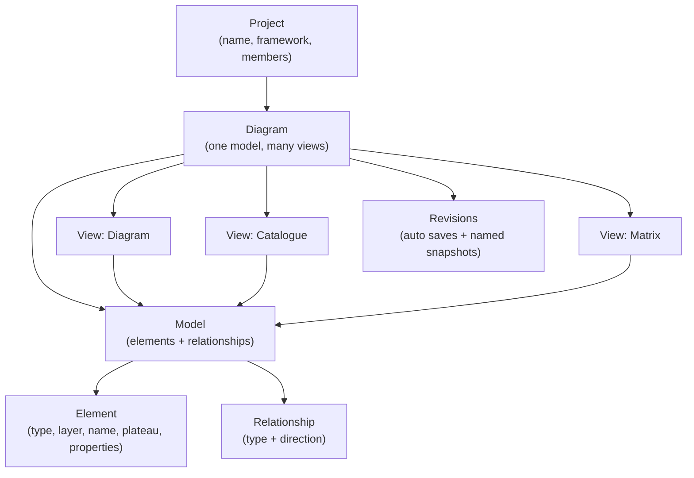
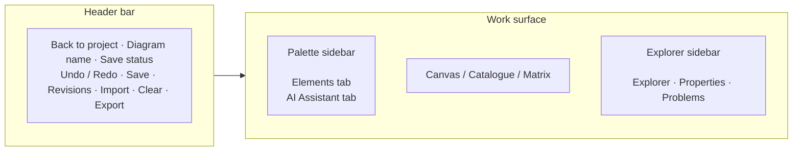

# EAsync — User Manual

**Enterprise architecture modelling in the browser**

Version 1.0 · Applies to the EAsync web client (Angular 22 build)

---

## Table of contents

1. [Introduction](#1-introduction)
2. [Before you start](#2-before-you-start)
3. [Key concepts](#3-key-concepts)
4. [Signing in](#4-signing-in)
5. [Projects](#5-projects)
6. [Project members and roles](#6-project-members-and-roles)
7. [Diagrams](#7-diagrams)
8. [The editor workspace](#8-the-editor-workspace)
9. [Drawing and editing a diagram](#9-drawing-and-editing-a-diagram)
10. [Element properties and metadata](#10-element-properties-and-metadata)
11. [Views: Diagram, Catalogue and Matrix](#11-views-diagram-catalogue-and-matrix)
12. [Viewpoints and frameworks](#12-viewpoints-and-frameworks)
13. [Model validation (Problems)](#13-model-validation-problems)
14. [Plateau gap analysis and work packages](#14-plateau-gap-analysis-and-work-packages)
15. [Version history and revisions](#15-version-history-and-revisions)
16. [The AI Assistant](#16-the-ai-assistant)
17. [Import and export](#17-import-and-export)
18. [Saving, autosave and conflicts](#18-saving-autosave-and-conflicts)
19. [Language and theme](#19-language-and-theme)
20. [Keyboard shortcuts](#20-keyboard-shortcuts)
21. [Troubleshooting and FAQ](#21-troubleshooting-and-faq)
22. [Appendix A — Role permission matrix](#appendix-a--role-permission-matrix)
23. [Appendix B — Element palette reference](#appendix-b--element-palette-reference)
24. [Appendix C — Relationship reference](#appendix-c--relationship-reference)
25. [Appendix D — Validation codes](#appendix-d--validation-codes)
26. [Appendix E — Deployment and administration](#appendix-e--deployment-and-administration)
27. [Appendix F — Glossary](#appendix-f--glossary)

---

## 1. Introduction

EAsync is a browser-based enterprise architecture modelling tool. It lets an architecture team
build a single ArchiMate 3.2 model of an organisation — capabilities, business processes,
applications, technology, motivation and migration planning — and then present that one model
through several different views:

- **Diagram views** — free-form ArchiMate drawings on a canvas.
- **Catalogue views** — a sortable, exportable table of every element in scope.
- **Matrix views** — a layer-by-layer relationship grid.

Because views read from one shared model, renaming an element, changing its type, or adding an
attribute in one place is reflected everywhere that element appears.

On top of the model, EAsync provides:

| Capability | What it gives you |
|---|---|
| Frameworks | ArchiMate 3.2 viewpoints plus TOGAF ADM and MyGovEA framing that steer the palette and the assistant |
| Validation | Continuous checking of relationships against ArchiMate 3.2 rules, with an exportable report |
| Migration planning | Baseline → transition → target gap analysis and TOGAF work packages |
| Version history | Automatic saves plus named snapshots you can preview and restore |
| AI Assistant | Prompt-driven model changes that you review as a plan before anything is applied |
| Interoperability | Import and export `.archimate` exchange files, PNG and SVG images, CSV reports |
| Collaboration | Project membership with Owner / Editor / Viewer roles |
| Bilingual UI | English and Bahasa Malaysia |

### Who this manual is for

- **Enterprise architects** who will build and maintain models.
- **Business and solution architects** who contribute views for their domain.
- **Architecture reviewers and stakeholders** who only need to read, validate and export.
- **Administrators** who deploy the client and connect it to the API (Appendix E).

### How to read it

If you are new to EAsync, read chapters 2–4 and then walk through chapters 5–9 in order. After
that, read the chapter for the feature you need. The appendices are reference material:
permissions, the element palette, relationship rules, validation codes, deployment and a
glossary.

> **Convention used in this manual.** UI labels are written in **bold** exactly as they appear
> on screen, for example **Save**, **Elements**, **Viewpoint**. Keyboard keys are written as
> `Ctrl` + `Z`; on macOS the same shortcuts work with `Cmd` in place of `Ctrl` unless stated
> otherwise.

---

## 2. Before you start

### 2.1 Browser requirements

EAsync is a modern single-page application. Use a current version of one of:

- Google Chrome or Microsoft Edge (recommended)
- Mozilla Firefox
- Safari 16 or later

The client needs:

- **JavaScript enabled** — the application will not run without it.
- **Canvas rendering** — the diagram editor draws with the HTML canvas element, so hardware
  acceleration should be left on for large diagrams.
- **Cookies/local storage** — the sign-in session and your language and theme preferences are
  kept in browser storage. Using a private window works, but preferences are discarded when you
  close it.
- **Network access to the EAsync API** — the client talks to a separate API service; if that
  service is unreachable, sign-in and saving will fail (see Chapter 21).

### 2.2 Accounts

You need an EAsync account. Accounts are created by whoever administers your EAsync deployment
and are matched to the sign-in providers that deployment has enabled. There is no self-service
registration screen in the client.

### 2.3 What you should know first

EAsync assumes you understand the basics of the ArchiMate 3.2 language: layers, elements and
relationship types. If you are new to ArchiMate, the palette in Appendix B and the relationship
reference in Appendix C are a compact primer. You do **not** need to know TOGAF to use the tool,
but the TOGAF-aware features (the AI assistant's ADM phase selector and the work-package
grouping in the plateau planner) assume you do.

---

## 3. Key concepts

Understanding these seven ideas makes the rest of the manual straightforward.



### Project

A container that groups related diagrams and the people who work on them. Each project has a
**name**, an optional **description**, and a **framework** (TOGAF or MyGovEA). The framework
decides which phases, principles and artefacts guide the assistant in that project.

### Diagram

The unit you open in the editor. A diagram is *not* one picture — it is a **model** plus one or
more **views** over that model. When you create a diagram you give it a name; you then add views
inside it.

### View

A presentation of the model. Three content types exist:

| Content type | Purpose |
|---|---|
| **Diagram** | A drawing you lay out on the canvas |
| **Catalogue** | A table of elements with sortable columns and CSV export |
| **Matrix** | A grid crossing two layers, marking where relationships exist |

Every view can carry a **viewpoint**, which narrows what the view shows and what the palette
offers.

### Model element

A thing in your architecture — a capability, a business process, an application component, a
node, a goal. Each element has an **ArchiMate type**, a **layer**, a **name**, and optional
metadata (domain, plateau, lifecycle state, owner, classification, reference model, reference
code, custom properties). The same element can appear on many diagram views; changing its
properties changes all of them.

### Relationship

A typed, directed link between two elements — for example *Application Component* **serving**
*Business Service*. Relationship types available in EAsync are listed in Appendix C.

### Plateau

A point in the migration timeline: **Baseline** (today), **Transition** (an intermediate state),
**Target** (the future state). Tagging elements with a plateau is what makes the gap analysis
and roadmap features work.

### Revision

A saved state of the whole diagram. EAsync records **automatic** revisions as you work and lets
you record **named snapshots** at meaningful moments.

---

## 4. Signing in

### 4.1 The sign-in page

Open the EAsync address your administrator gave you (for example
`https://ia.unimas.my/easync/`). You are redirected to the **Sign in** page.

1. The page lists one button per sign-in provider enabled for your deployment, each labelled
   **Continue with** *provider name* (for example "Continue with Microsoft").
2. Choose the provider you use for your organisation's account.
3. You are handed to that provider to authenticate. After you approve access, you return to
   EAsync at the callback address and land on **Projects**.

EAsync never sees your provider password. It receives a short-lived hand-off token, exchanges it
for its own session, and keeps that session in browser storage.

### 4.2 If sign-in fails

The sign-in page shows a message when the provider returns without a usable session:

| Message | Meaning | What to do |
|---|---|---|
| **Your session expired. Please sign in again.** | The hand-off token was already used or timed out | Sign in again from the button |
| **Your account has no email address.** | The provider did not release an email address | Ask your provider administrator to release the email claim, or use another provider |
| **That sign-in provider is not supported.** | The provider is not enabled for EAsync | Use one of the listed providers |
| **Sign-in failed (code)** | An unrecognised error code | Note the code and pass it to your administrator |

### 4.3 Developer sign-in

Development builds additionally show a **Developer sign-in** form (email + display name) that
issues a session directly. It only works when the API has developer login enabled, and it is
never available in a production build. Use it for local testing, not for real work.

### 4.4 Signing out

Use **Sign out** in the top-right of the editor header, or the account menu on smaller screens
(**More actions**). Signing out clears the session from the browser and revokes it on the server.

### 4.5 Sessions that expire

If your session expires while you are working, the next request fails and you are returned to
the sign-in page with the "session expired" message. **Unsaved canvas changes are lost** when
this happens, so save deliberately before long breaks (see Chapter 18).

---

## 5. Projects

After signing in you land on **Projects**, the list of every project you are a member of.

### 5.1 Reading the project list

Each project is a card showing:

| Field | Meaning |
|---|---|
| **Name** | The project name |
| Role badge | **OWNER** (blue), **EDITOR** (light blue) or **VIEWER** (grey) — your role in that project |
| Description | The project description, if one was given |
| **Framework** | The project's framework, shown by short name (**TOGAF** or **MyGovEA**) |
| **Diagrams** | How many diagrams the project contains |
| **Members** | How many people have access |
| **Updated** | When the project was last changed |

### 5.2 Creating a project

1. Select **New project**.
2. Enter a **Name** (required).
3. Choose a **Framework** — TOGAF or MyGovEA. The form explains that the framework decides
   which phases, principles and artefacts guide the assistant. You can change it later with
   **Edit**.
4. Optionally enter a **Description**.
5. Confirm. You become the project's **Owner** and it appears at the top of your list.

### 5.3 Opening a project

Select **Open** on the card (or select the card's title). The project page lists its diagrams and
its members — see Chapter 7.

### 5.4 Editing a project

Select **Edit** on the card. You can change the name, the framework and the description. **Edit**
is available to Owners and Editors, not to Viewers.

### 5.5 Deleting a project

Select **Delete** on the card. Only an **Owner** can delete a project. EAsync asks you to
confirm, and warns that deletion removes:

- every diagram in the project,
- every view inside those diagrams,
- every revision recorded for them,

for **every** member, permanently. There is no undo and no recycle bin. Export anything you may
need first (Chapter 17).

---

## 6. Project members and roles

Open a project to manage who can work on it. The **Members** list sits below the diagram list.

### 6.1 The three roles

| Role | Typical use | Can do |
|---|---|---|
| **Owner** | Project lead / chief architect | Everything an Editor can do, plus manage members, change roles, remove members, edit and delete the project |
| **Editor** | Architects and analysts | Create, edit and delete diagrams, edit the model, record snapshots, use the assistant |
| **Viewer** | Reviewers and stakeholders | Open diagrams in read-only mode, inspect properties, validate, view catalogue and matrix views, export |

Appendix A gives the complete permission matrix.

### 6.2 Inviting a member

1. In the **Members** section, enter the person's **Email**.
2. Choose a **Role** — **Editor** (default) or **Viewer**.
3. Confirm the invitation.

The invitee appears in the list immediately with a **Not signed in yet** badge. Their email is
hidden from other members while the invitation is pending. The invitation is filled in
automatically the first time that person signs in with a matching email address — there is no
separate acceptance email to chase.

### 6.3 Changing a member's role

An **Owner** selects the role control next to a member and picks **Editor** or **Viewer**. The
change takes effect on that member's next request. Demoting an Editor to Viewer does not discard
their work; it only prevents further edits.

### 6.4 Removing a member

An **Owner** selects **Remove**. A two-step confirmation (**Remove this member?**) guards the
action. Removing a member revokes their access immediately. Their earlier saves remain part of
the diagram's history.

### 6.5 What non-owners see

Editors and Viewers see the member list and their own role badge, but no role controls and no
invite form. The **Members** section becomes a read-only roster.

---

## 7. Diagrams

A diagram is the working container: one model, one or more views, and a shared version history.

### 7.1 The project page

Select **Open** on a project card. The page shows:

- A breadcrumb **All projects** that returns you to the list.
- The project name and your role badge.
- The project description.
- **New diagram** — present only if you can edit the project.
- The list of diagrams.
- The **Members** section (Chapter 6).

### 7.2 Reading a diagram card

| Field | Meaning |
|---|---|
| **Views** | How many views the diagram holds |
| **Version** | The current version number, incremented on every save |
| **Updated** | When the diagram was last saved |
| **By** | Who saved it last |
| **Open** | Open the diagram in the editor |
| **Delete** | Remove the diagram and its history |

### 7.3 Creating a diagram

1. Select **New diagram**.
2. Enter a **Name** for the diagram (this is the container name, not a view name).
3. Confirm.

The diagram is created with a starter view, and the editor opens. Views are added later from
inside the editor (Chapter 11).

> **Name it for the subject, not the picture.** A good diagram name describes the architecture
> it holds — "Customer Onboarding Architecture" — because it becomes the model that all of its
> views share.

### 7.4 Opening a diagram

Select **Open**. The editor loads the diagram, its views and its revision metadata. If your role
is **Viewer**, the editor opens in read-only mode and shows the **Read only** badge next to the
diagram name.

### 7.5 Deleting a diagram

Select **Delete** on the diagram card and confirm. The diagram, every view inside it, and every
revision are removed permanently. Export an `.archimate` file first if the diagram has any
ongoing value (Chapter 17).

---

## 8. The editor workspace

The editor is a full-window workspace. Its regions are consistent: chrome across the top, a
tools panel on the left, the work surface in the middle, and an information panel on the right.



### 8.1 The header bar

The header is your control strip. From left to right:

| Control | Purpose |
|---|---|
| **Back to project** arrow | Returns to the project page (you are warned about unsaved changes) |
| Palette toggle (small screens) | Opens the Elements / AI Assistant panel as an overlay |
| EAsync logo | Non-interactive branding |
| Diagram name | The name entered when the diagram was created |
| Save status | **Read only**, or one of **All changes saved**, **Unsaved changes**, **Saving…**, **Save failed** |
| **EN / BM** | Switches the interface language (Chapter 19) |
| Sun / moon icon | Switches between light and dark theme (Chapter 19) |
| **Undo** / **Redo** | Step backwards and forwards through your edits; greyed out when there is nothing to undo or redo |
| **Save** | Forces an immediate save; shows a spinner while saving. The tooltip reads **Save now (autosave is on)** |
| **Revisions** | Opens version history (Chapter 15) |
| **Import** | Loads an `.archimate` file (Chapter 17) |
| **Clear** | Empties the canvas and the model (Chapter 9.9) |
| **Export PNG** | Downloads the active view as a PNG image |
| Name and initials avatar | Identifies the signed-in account |

Saving, undo, import, clear and export are hidden or disabled in read-only mode.

On screens narrower than the medium breakpoint the secondary actions collapse into a **More
actions** menu containing **Revisions**, **Import**, **Export PNG**, **Export SVG**,
**Export ArchiMate**, **Clear diagram**, your account details and **Sign out**.

### 8.2 The palette sidebar (left)

The palette has two tabs: **Elements** and **AI Assistant**. The panel title follows the active
tab.

**Elements tab**

- A **Connect** button and an adjacent relationship-type dropdown. **Connect** turns connection
  mode on (its label changes to **Connecting**); the dropdown chooses the relationship type used
  by connection mode and by Shift+drag connections.
- A viewpoint banner when the active view has a viewpoint: the viewpoint name, a summary such as
  **Showing 24 of 57 elements**, and **Filter** / **Show all** to toggle filtering.
- An accordion of palette categories, each with a colour dot and an element count. See Appendix B
  for the full list.
- Each element is a draggable tile. Select it to drop a copy in the middle of the canvas, or
  drag it to the exact position you want.

**AI Assistant tab** — described in Chapter 16.

### 8.3 The canvas

The canvas is the drawing surface for **Diagram** views. It shows a light grid, and:

- A hint pill in the corner: **Shift + Drag to connect**, **Space + Drag to pan**,
  **Ctrl + Z to undo**.
- A banner while connection mode is active, describing the next click.
- A floating toolbar on the selected object with **Bring to front**, **Send to back**, **Edit
  properties** (pencil) and **Delete** (trash).
- Short toast messages for completed actions (for example "Connection created.",
  "Export successful.").

For **Catalogue** and **Matrix** views the canvas is hidden and replaced by the corresponding
data view. The canvas stays mounted in the background, so switching back is instant and loses
nothing.

### 8.4 The explorer sidebar (right)

Three tabs: **Explorer**, **Properties** and **Problems**. The **Problems** tab carries a red
badge with the current error count.

- **Explorer** — see 8.5.
- **Properties** — edits the selected element or relationship (Chapter 10).
- **Problems** — validation issues (Chapter 13).

### 8.5 Inside the Explorer tab

Top to bottom:

1. **Diagrams (Views)** — the list of views in this diagram, the active one marked
   **(Current)**, plus a dashed **+ New View** button.
2. **Viewpoint** — a **View content** select (Diagram / Catalogue / Matrix), a viewpoint select
   defaulting to **No viewpoint**, and, when a viewpoint is chosen, its **Concern**, its
   **Stakeholders** and the hint "Narrows the palette and the problems list to what this view is
   for."
3. **Model Repository** — appears once the model has elements. A **Search model** box with the
   placeholder "Name, type, domain, property…" filters elements by name, ArchiMate type, domain,
   plateau, lifecycle state, reference model, reference code, owner, classification and custom
   property values. Results are grouped by layer. Each row shows an occurrence badge whose
   tooltip lists the occurrences and the view count. Repository rows can be dragged onto the
   canvas to add another occurrence of the same element.
4. **Current layers** — the elements on this view, grouped by layer.
5. **Relationships** — every relationship on the view, written as *SOURCE → TARGET* with a type
   badge.
6. **Plateau planner** — see Chapter 14.

If the model is empty, the panel shows **Model is empty** instead of the repository.

### 8.6 Responsive behaviour

- **Below the large breakpoint** the two sidebars become overlay panels with a dimmed backdrop;
  the header gains toggles for them and tapping the backdrop closes them.
- **Below the medium breakpoint** the header collapses its secondary actions into **More
  actions**, and adding an element from the palette automatically closes the palette so you can
  see the result.

### 8.7 Opening and leaving the editor

While the diagram loads you see a spinner and **Loading diagram…**. If the diagram cannot be
loaded (deleted, or no access) you see **Cannot open this diagram** with a link back to the
project.

If you have unsaved changes and try to close the tab, refresh, or navigate away, the browser
asks you to confirm. Saving happens automatically in most cases, so the warning mainly protects
work made in the seconds before you leave.

---

## 9. Drawing and editing a diagram

All editing gestures below require edit rights. In read-only mode you can select objects and
read their properties, pan, zoom and open linked views, but nothing can be created or changed.

### 9.1 Adding an element

Three equivalent routes:

1. **Click** an element tile in the palette — a copy lands near the middle of the visible canvas
   with a small random offset so repeated clicks do not stack.
2. **Drag** a tile from the palette and drop it where you want it — the drop position snaps to
   the grid.
3. **Drag** an element from the **Model Repository** — this adds another occurrence of the
   *existing* model element, not a new one.

Newly added shapes are selected automatically, so you can immediately rename them in
**Properties**.

### 9.2 Selecting, moving and resizing

- **Click** an object to select it. Drag on empty canvas to rubber-band select several objects.
- **Drag** a selected object to move it. Movement snaps to the grid, and children inside a
  container move with it.
- **Drag a corner handle** to resize. Text is never stretched; groups re-lay out their contents
  and keep their stroke weight.
- The floating toolbar on the selection offers **Bring to front** and **Send to back** for
  z-order.

### 9.3 Creating a relationship

**Shift + drag** from source to target:

1. Hold `Shift`.
2. Press on the source element and drag towards the target. A dashed blue preview line follows
   the pointer.
3. Release over the target. A relationship of the type currently chosen in the palette dropdown
   is created, and a toast confirms **Connection created.**

**Connection mode** is the alternative, and it is easier on touch screens:

1. Select **Connect** in the palette. A banner explains what to do next.
2. Select the source element, then the target element. The connection is created with the
   selected relationship type.
3. Select **Connect** again (now **Connecting**) or press `Escape` to leave connection mode.

Connections stay attached when you move either end; they re-route automatically, following any
bendpoints you have set.

### 9.4 Changing a relationship type

Select the relationship, then use **Relationship Type** in the **Properties** tab. The change is
immediate and validation re-runs, so an invalid combination is reported straight away.

### 9.5 Bendpoints

Long relationships often need routing around other content:

- **Double-click** a relationship line to insert a bendpoint at the closest segment.
- **Drag** a bendpoint dot to move it.
- **Double-click** a dot to remove it.
- Or use **Bendpoints** in the Properties tab: **Add bend** and **Clear bends**.

### 9.6 Nesting, containment and composition

EAsync understands ArchiMate nesting.

- Drop an element so it sits **inside** a container shape — a Grouping, Location, or another
  element that can contain children. It becomes a child and moves with its parent.
- Drop an element inside an element that is **not** a container and EAsync creates a
  **composition** relationship instead, with the toast "Composition created; hidden because
  nesting already shows it." Composition is drawn implicitly by containment rather than as an
  extra line.
- Select an element that has children and use **Collapse contents** / **Expand contents** in the
  Properties tab to fold a large container down to a single box. Contents of a collapsed shape
  are not hit-tested, so the box behaves like a single element.

### 9.7 Renaming

- **Double-click** a shape to open the **Edit label** dialog, then type the name and confirm.
- Or edit **Name** directly in the **Properties** tab.

Renaming an element renames it in **every** view that shows it, because the name belongs to the
model element, not the picture.

> If the shape is linked to another view, double-clicking navigates to that view instead of
> renaming. Use the Properties tab to rename in that case.

### 9.8 Copy, paste, duplicate and delete

| Action | Gesture |
|---|---|
| Copy | `Ctrl` + `C` (copies the selection, including multi-selections) |
| Paste | `Ctrl` + `V` (offsets the copies slightly) |
| Delete | `Delete` or `Backspace`, or the trash button on the floating toolbar |
| Undo | `Ctrl` + `Z` |
| Redo | `Ctrl` + `Shift` + `Z` or `Ctrl` + `Y` |

Copy and paste works within the model: pasting an element that is not part of the current view
produces "Nothing to paste: the copied element is not part of this view." Relationships between
copied elements are carried across when both ends are present.

### 9.9 Clearing the canvas

**Clear** in the header (or **Clear diagram** in the overflow menu) empties the canvas **and** the
model repository for this diagram. EAsync asks for confirmation first, and the toast afterwards
reads "Canvas and Global Repository cleared." The action is undoable with `Ctrl` + `Z` only
until you save; after that it is permanent. Export first if the content matters.

### 9.10 Panning and zooming

| Action | Gesture |
|---|---|
| Pan | `Space` + drag, or `Alt` + drag, or middle-mouse drag |
| Scroll vertically / horizontally | Mouse wheel / `Shift` + wheel or trackpad gesture |
| Zoom | `Ctrl` + wheel (or `Cmd` + wheel), 10 % to 500 % |
| Fit to screen | Collapse the sidebars with their header toggles, then pan and zoom to frame the view |

The cursor changes to a grab hand while panning.

### 9.11 Editing with the keyboard

`Escape` is a general cancel: it exits connection mode, closes an open dialog, and then closes the
mobile sidebars. Text inputs keep their native undo behaviour, so `Ctrl` + `Z` inside a field
undoes typing rather than the diagram.

The complete shortcut list is in Chapter 20.

### 9.12 A first diagram, end to end

1. Create the diagram (Chapter 7.3) and open it.
2. In **Explorer → Diagrams**, rename the starter view with **+ New View** if you prefer a clean
   view, or just use the one you have.
3. Open the **Viewpoint** select and choose a viewpoint, for example **Application Cooperation**.
   The palette now filters to the elements that viewpoint admits.
4. Drag four **Component** tiles from the **Application** category onto the canvas.
5. Rename each one in **Properties** (for example "CRM", "Billing", "Data Warehouse", "Reporting").
6. Set **Plateau** to **Baseline** on the first three and **Target** on a new element.
7. Hold `Shift` and drag from "CRM" to "Billing" to draw a **Flow**.
8. Open **Problems** to confirm there are no errors.
9. Select **Save**.
10. Select **Export ArchiMate** if you want a copy outside EAsync.

You now have a model with one diagram view, one viewpoint, four elements and one relationship —
and every other view you create will draw from the same model.

---

## 10. Element properties and metadata

Select an object and open the **Properties** tab. What you see depends on what is selected.

### 10.1 Nothing selected

**Select an element to view properties** is shown. Viewers also see: "Read only: you can inspect
properties but not change them."

### 10.2 A shape is selected

| Group | Field | Notes |
|---|---|---|
| General | **Name** | The element's display name; hidden for connections in read-only mode |
| General | **Parent Group** | Re-parent a shape into a container, or **None** |
| General | **Link to View** | Makes the shape a navigation shortcut to another view in the diagram |
| General | **Color** | Overrides the layer colour; **Reset** restores it |
| **Model Element** | **ArchiMate Type** | Grouped by layer; changing the type re-styles the shape and re-runs validation |
| | **Domain** | Framework segment, for example the BDAT domains *Perkhidmatan, Data, Aplikasi, Teknologi* |
| | **Plateau** | **Not set**, **Baseline**, **Transition**, **Target** |
| | **Lifecycle** | **Current**, **Planned**, **Phasing out** |
| | **Owner** | Accountable person or team |
| | **Classification** | Sensitivity or criticality classification used by your organisation |
| | **Reference Model** | The reference model this element maps to |
| | **Reference Code** | The code or identifier in that reference model |
| | **Properties** | Arbitrary key/value pairs; **Add Property** and **Remove** per row |

Everything in the **Model Element** fieldset is **model-level**, not view-level. The panel states
it plainly: *"Changes apply to every view that shows this element."* That is the single most
important behaviour to understand about EAsync metadata — set an element's owner once and every
catalogue, matrix and diagram view agrees.

### 10.3 A relationship is selected

| Field | Notes |
|---|---|
| **Relationship Type** | Any of the eleven ArchiMate relationship types (Appendix C) |
| **Documentation** | Free text describing the relationship |
| **Bendpoints** | **Add bend** / **Clear bends**, with the hint "Double-click a line to add a bendpoint, double-click a dot to remove it." |

The relationship's **Name** field can also be set, and is what the **Relationships** list in the
Explorer shows.

### 10.4 Practical metadata guidance

- **Name consistently.** "CRM System" and "CRM" read as two systems in a catalogue export.
- **Use Plateau on everything you will roadmap.** Untagged elements are ignored by the gap
  analysis.
- **Use Domain for reporting slices.** Domain values appear as sortable columns in catalogue
  views and in the CSV export, which is how most teams build their architecture inventory.
- **Prefer custom Properties and Reference Code over stuffing text into the name.** They are
  searchable (the repository search covers custom property values), sortable and exportable.

---

## 11. Views: Diagram, Catalogue and Matrix

A diagram holds multiple views. All views read the same model, so they can be created at any time
and immediately reflect the current state.

### 11.1 Listing and switching views

The **Explorer → Diagrams (Views)** section lists every view. The active view is marked
**(Current)**. Select any entry to switch to it. Your canvas state for each diagram view is
preserved while the diagram is open.

### 11.2 Creating a view

1. Select **+ New View**.
2. Enter a **View name** — for example "Application Layer".
3. Choose a **Viewpoint**; the list starts with **No viewpoint**.
4. Choose **Content**:
   - **Diagram** — a drawing surface.
   - **Catalogue** — a table.
   - **Matrix** — a layer grid.

   The dialog's help text explains that content decides how the view presents the model.
5. Confirm.

### 11.3 Changing a view's content type or viewpoint

Use the **Viewpoint** block in the Explorer tab:

- **View content** — switch between Diagram, Catalogue and Matrix at any time. Diagram content is
  not lost when you switch away; it is simply hidden.
- Viewpoint select — apply or clear a viewpoint. Choosing a viewpoint narrows the palette, the
  catalogue and matrix scope, and the validation scope.

Only editors can change these. Viewers see the current values but cannot change them.

### 11.4 Diagram views

Covered in Chapters 9 and 10. A diagram view is the only place elements can be drawn, moved or
connected.

### 11.5 Catalogue views

A catalogue view is a table of the model.

| Element | Behaviour |
|---|---|
| **Search elements** | Filters across names and metadata |
| **Only elements this viewpoint admits** | Checkbox (shown when the view has a viewpoint) that scopes the table to the viewpoint's element set |
| Column headers | Sort by **Name**, **Type**, **Layer**, **Domain**, **Plateau**, **Lifecycle**, **Reference model**, **Reference code**, **Owner**, **Classification**, **Views** |
| Custom-property columns | Up to eight custom property keys become their own columns automatically |
| **Export CSV** | Downloads the current table |
| **Showing N of M elements** | How many elements the filter left visible |
| **Rename** on the Name cell | Inline rename for editors; renames the model element everywhere |

Empty states: **No element matches the current filter.** when a filter excludes everything, and
**The model has no elements yet. Draw them on a diagram view first.** on a brand-new diagram.

### 11.6 Matrix views

A matrix view crosses two layers and shows where relationships exist.

| Element | Behaviour |
|---|---|
| **Rows** | The layer supplying row elements |
| **Columns** | The layer supplying column elements |
| **Show elements with no relationship** | Includes empty rows and columns, useful when auditing coverage |
| Grid | Sticky row and column headers; each populated cell shows a count badge |
| **Export CSV** | Downloads the matrix |
| **Row ↓ / Column →** | Corner label explaining the orientation |

Two behaviours are worth knowing:

- **Relationships are indexed in both directions.** A dependency is worth seeing whichever
  direction it was drawn in, so a relationship from an Application element to a Business element
  appears in both the row and the column that match.
- **Viewpoint scoping applies.** If the view has a viewpoint, only admitted elements are counted.

Empty state: **No element of these layers is in scope. Pick another layer or a viewpoint with
more elements.**

### 11.7 Choosing the right content type

| You want to… | Use |
|---|---|
| Present architecture to people | Diagram |
| Audit what exists and who owns it | Catalogue |
| Answer "what talks to what" between layers | Matrix |
| Produce an inventory export | Catalogue with **Export CSV** |
| Prove coverage or find gaps in integration | Matrix with **Show elements with no relationship** |

---

## 12. Viewpoints and frameworks

### 12.1 What a viewpoint does

A viewpoint is a named purpose for a view: a concern it answers, the stakeholders it serves, and
the set of ArchiMate element types it admits. Applying one to a view has three effects:

1. **The palette narrows** to admissible elements, with a banner showing **Showing N of M
   elements** and a **Show all** escape hatch.
2. **Catalogue and Matrix views scope** to the admitted elements.
3. **Problems can be scoped** to the viewpoint (Chapter 13).

EAsync ships 41 viewpoints: 22 ArchiMate, 14 TOGAF and 5 MyGovEA.

### 12.2 ArchiMate viewpoints

| Viewpoint | Concern it answers |
|---|---|
| **Organization** | Who carries out the work, and how is the organisation structured? |
| **Business Process Cooperation** | How do business processes cooperate to deliver value? |
| **Product** | What products and services are offered, and what do they contain? |
| **Application Cooperation** | How do application components cooperate? |
| **Application Usage** | Which applications support which business processes? |
| **Implementation and Deployment** | How is the architecture implemented and deployed? |
| **Technology** | What technology infrastructure exists and how is it structured? |
| **Information Structure** | How is information structured, and what accesses it? |
| **Service Realization** | Which elements realise a service? |
| **Goal Realization** | Which elements realise a goal? |
| **Goal Contribution** | Which elements contribute positively or negatively to a goal? |
| **Principles** | Which principles govern the architecture? |
| **Requirements Realization** | Which elements realise a requirement? |
| **Motivation** | Why does the architecture look like this? |
| **Strategy** | What is the strategic direction and how is it resourced? |
| **Capability Map** | What capabilities exist and how do they decompose? |
| **Outcome Realization** | Which outcomes does the architecture deliver? |
| **Resource Map** | What resources underpin capabilities? |
| **Value Stream** | How does value flow through the organisation? |
| **Physical** | What physical equipment, facilities and materials exist? |
| **Stakeholder** | Who are the stakeholders and what do they care about? |
| **Layered** | A cross-layer overview |

Each viewpoint shows its **Concern** and **Stakeholders** in the Explorer tab, which makes them
self-documenting when you hand a view to a reviewer.

### 12.3 TOGAF viewpoints and ADM phases

The TOGAF viewpoints are mapped to ADM phases, so an assistant prompt or a view can be anchored
to a phase of the method.

| Code | Phase | Purpose | Typical artefacts |
|---|---|---|---|
| Preliminary | Architecture Capability | Establish the practice, principles and governance | Architecture Principles, Architecture Repository, Request for Architecture Work |
| Phase A | Architecture Vision | Agree scope, stakeholders, concerns, high-level vision | Stakeholder Map, Solution Concept, Value Chain, Architecture Vision |
| Phase B | Business Architecture | Baseline and target business architecture | Capability Map, Value Stream Map, Business Process Map, Organization Map, Business Service/Function Catalog |
| Phase C | Information Systems Architectures | Data and application architectures | Application Portfolio Catalog, Application Communication, Data Entity/Component Catalog, Application and User Location |
| Phase D | Technology Architecture | Technology and physical architecture | Technology Standards Catalog, Technology Portfolio Catalog, Environments and Locations, Platform Decomposition |
| Phase E | Opportunities and Solutions | Group work into projects; identify transition architectures | Project Context, Benefits diagram, Work Package definitions, Consolidated Gaps |
| Phase F | Migration Planning | Sequence work packages into plateaus; produce the roadmap | Implementation and Migration Plan, Architecture Roadmap, Transition Architecture definitions |
| Phase G | Implementation Governance | Govern delivery against the target | Architecture Contract, Compliance Assessment, Compliance Review |
| Phase H | Architecture Change Management | Manage change to the deployed architecture | Change Request, Architecture Requirements Specification, Change Management plan |
| Requirements | Continuous Requirements Management | Capture and govern requirements across all phases | Requirements Catalog, Requirements Impact Assessment, Architecture Requirements Specification |

The assistant also understands five architecture **domains** — **Business**, **Data**,
**Application**, **Technology** and **Cross-cutting** — each of which scopes which ArchiMate
layers a generated model may use.

### 12.4 MyGovEA

Projects whose framework is **MyGovEA** use the Malaysian Government Enterprise Architecture
profile (mandate: PKPA Bil. 1/2020 and the MyGovEA Master Plan). The client ships five MyGovEA
viewpoints:

| Viewpoint | Concern |
|---|---|
| **EA Blueprint** | The whole-of-agency architecture, expressed across the BDAT domains |
| **Domain Architecture** | The architecture of one BDAT domain |
| **Service Architecture** | Services offered and how they are delivered |
| **Implementation Plan** | How the architecture will be delivered |
| **Compliance and Monitoring** | How compliance is evidenced and monitored |

The **Domain** field on an element accepts the BDAT segments, so MyGovEA reporting works through
the catalogue and CSV export.

### 12.5 Choosing a framework

The framework is a project setting (**Edit** on the project card). It does not restrict what you
can model — ArchiMate 3.2 is the notation in both cases — it changes which phases, principles and
artefacts the assistant is steered by and which viewpoint set is relevant.

### 12.6 Practical advice on viewpoints

- **One purpose per view.** A "Business and Application and Technology" view answers nothing
  well; three viewpoint-scoped views answer everything.
- **Use "No viewpoint" deliberately** for free-form working views, then apply a viewpoint when
  you hand the view over.
- **Let the palette filter help you.** If the element you want is missing from the palette, the
  viewpoint probably does not admit it — that is a signal, not a bug. Use **Show all** to override.

---

## 13. Model validation (Problems)

EAsync validates the model continuously against ArchiMate 3.2 relationship rules. Validation is
computed from the model catalogue, not from the drawing, so it is the same in every view and
updates the instant you change anything.

### 13.1 Opening the panel

Select the **Problems** tab in the explorer. The tab carries a red badge with the current error
count, so you can see at a glance whether the model is clean without opening it.

### 13.2 Reading the panel

| Element | Behaviour |
|---|---|
| Severity filter | **All problems**, **Errors**, **Warnings**, **Information** |
| **Export Report** | Downloads `easync-validation.csv` (with a byte-order mark so Excel detects UTF-8) containing Severity, Issue, Detail, Code |
| Summary line | *N errors · N warnings · N infos* |
| **Only elements this viewpoint admits** | Switch, shown only when the active view has a viewpoint |
| Issue list | Each row shows severity, the issue description and the language-neutral detail |

Selecting an issue **selects the offending element on the canvas**, so you can go straight from
problem to fix. For relationship issues it falls back to selecting the relationship.

Empty state: **No problems found.** The panel footer states the ruleset: "Checked against the
ArchiMate 3.2 relationship rules."

### 13.3 What is checked

| Severity | Checks |
|---|---|
| Error | A relationship points at an element that is not in the model; an element relates to itself; ArchiMate forbids any relationship between these two types; ArchiMate forbids this specific relationship type between these two types |
| Warning | The same relationship is modelled more than once; an element has no name; an unknown ArchiMate type (its relationships were not checked); a junction joins more than one relationship type |
| Information | Reserved for advisory findings |

Appendix D lists every code.

### 13.4 A validation workflow

1. Build the view.
2. Open **Problems**, filter to **Errors**.
3. Work down the list; each click jumps to the element.
4. Fix the relationship type, or delete the relationship, using the **Properties** tab.
5. Repeat until the error count is zero.
6. Export the report for the architecture review record.

> **Warnings are not noise.** Unnamed elements and duplicated relationships make catalogues and
> matrices unreliable. Clear them before exporting an inventory.

---

## 14. Plateau gap analysis and work packages

The **Plateau planner** turns the plateau tags you set on elements into a migration plan. It is
the implementation of the TOGAF Phase E/F transition-planning idea inside the model.

### 14.1 Where it lives

Open the **Explorer** tab and find the **Plateau planner** section, below the relationship list.

### 14.2 Using it

1. Choose a **From** plateau — **Baseline** by default.
2. Choose a **To** plateau — **Target** by default.
3. Review the **change list**. Each entry is a single model element, its change kind, and a
   tooltip showing *layer · ArchiMate type*.
4. Select any entry to select that element on the canvas and inspect it.
5. Read the **Work packages** list, grouped with their TOGAF phase code and element count, to see
   how the changes cluster into initiatives.
6. Export the plan for the roadmap document (see Chapter 17 for CSV and image export).

Empty state: **Pick two different plateaus to see what has to change.** If both selections are
identical the planner has nothing to show.

### 14.3 Change kinds

| Badge | Kind | Meaning |
|---|---|---|
| Red | **Retire** | In the source plateau, gone in the target |
| Green | **Introduce** | Absent in the source, present in the target |
| Amber | **Align** | Present in both, but its attributes or relationships change |
| Grey | **Retain** | Present in both with no change |

Use the badges to sanity-check a roadmap: a plan with a large **Retire** count and a large
**Introduce** count in the same work package is usually two initiatives that should be separated.

### 14.4 Getting useful results

- **Tag consistently.** Gap analysis only sees elements whose **Plateau** is set.
- **Use Transition.** A Baseline → Target plan with no transition plateau usually produces an
  unimplementable work package; add a transition plateau and compare Baseline → Transition, then
  Transition → Target.
- **Set Lifecycle** as well (**Current**, **Planned**, **Phasing out**) — it complements plateau
  tagging and appears as its own catalogue column.
- **Model work packages as elements** when you want them on the canvas; the planner groups by
  phase, and the diagram shows the sequencing (triggering relationships read left to right).

---

## 15. Version history and revisions

EAsync keeps two kinds of history: **automatic** revisions recorded as you work, and **named
snapshots** you create deliberately.

### 15.1 Opening version history

Select **Revisions** in the header (or **Revisions** in the **More actions** menu on small
screens). The dialog lists revisions newest first.

### 15.2 Reading a revision

| Field | Meaning |
|---|---|
| Label | Your snapshot label, or **Automatic save** |
| Badge | **Snapshot** for named revisions, **Auto** for automatic ones |
| Meta | *Version N · creator · date* |
| **Preview** / **Hide** | Expands a per-view table showing each view's name, **Shapes** and **Connections** counts |
| **Restore** | Rolls the diagram back to that revision |

Empty state: **No revisions have been recorded yet.**

### 15.3 Recording a named snapshot

1. Select **Revisions**.
2. Type a label — for example "Before refactor" or "Approved baseline".
3. Confirm.

Notes:

- A note in the dialog warns when the canvas has unsaved changes, because the snapshot will
  include them. That is usually what you want.
- Snapshots are cheap. Take one before any large restructure: a bulk delete, a re-layout, an
  assistant-driven change.
- Viewers cannot create snapshots.

### 15.4 Previewing a revision

Select **Preview** to see the per-view shape and connection counts, which is enough to tell a
small edit from an accidental clear without leaving the dialog.

### 15.5 Restoring a revision

1. Select **Restore** next to the revision.
2. Confirm with **Confirm restore**.

**Restore is blocked while you have unsaved changes.** The button is disabled with the tooltip
"Save your changes before restoring a revision". Save — or discard — first, then restore.

Restoring writes a new save. The revision you restored from remains in the list, so restoring is
itself reversible: restore again to an earlier point, or restore the revision you came from.

### 15.6 When to take a snapshot

| Moment | Why |
|---|---|
| Before a large reorganisation | Cheapest possible safety net |
| When a view is approved in a review | Creates an auditable "as approved" state |
| Before applying an AI-generated plan | Isolates assistant changes from your own work |
| Before an import | Import replaces content; a snapshot makes it reversible |
| End of a working session | Marks a clean handover point |

---

## 16. The AI Assistant

The assistant turns a natural-language request into a **plan** of model operations. Nothing is
applied until you review the plan and confirm it.

### 16.1 How it works, in one paragraph

You describe what you want — "capability map for retail banking with the application services
that realise it" — optionally anchored to a TOGAF ADM phase and an architecture domain. The
client sends the prompt, the phase, the domain and a description of the current diagram to your
API. The API calls the AI provider you configured and returns a structured plan. EAsync turns
that plan into a readable preview: a summary, the rationale, relevant principles, and a bullet
list of the changes it intends to make. Only when you select **Apply** does anything change on
the canvas.

### 16.2 Before you can use it

You need:

1. **Edit rights** on the diagram. Viewers see the message "You only have view access to this
   diagram."
2. **An AI provider configured for your account** — see 16.3.

If either is missing the assistant tells you which.

### 16.3 Configuring your AI provider

1. Open the **AI Assistant** tab in the palette.
2. Select **Settings**.
3. Fill in:

| Field | Notes |
|---|---|
| **API base URL** | The OpenAI-compatible endpoint, for example `https://api.openai.com/v1`. Also works with Azure OpenAI, OpenRouter, Ollama and LM Studio |
| **Model** | The model identifier, for example `gpt-4o-mini` |
| **API key** | Your key. Shown as a password field. A **Key stored** / **No key** badge tells you whether a key already exists |

4. Select **Save**. **Remove key** deletes the stored key.

Key handling, as explained in the form itself:

- The key is stored **server-side for your account** and is **never returned to the browser**.
  The field's placeholder changes when a key is already stored, so you can tell without exposing
  it.
- A leading `Bearer ` prefix and surrounding quotes are stripped automatically, so pasting a
  full authorization header value works.
- Any OpenAI-compatible endpoint is accepted, so you can keep the model on your own
  infrastructure (Ollama, LM Studio) if policy requires it.

If the provider rejects the request, the assistant opens **Settings** automatically so you can
correct the configuration.

### 16.4 Prompting

| Control | Purpose |
|---|---|
| **TOGAF ADM phase** | Anchors the request to a phase. The form shows the phase code and name, its purpose, and its typical **Artefacts** |
| **Architecture domain** | Business, Data, Application, Technology or Cross-cutting, which constrains the ArchiMate layers used |
| Prompt box | Your request in your own words |
| **Preview changes** | Generates the plan; the button reads **Thinking…** while busy |
| `Ctrl` + `Enter` | Sends the prompt |

The hint under the prompt reads: "The assistant proposes changes; nothing is applied until you
confirm. Press Ctrl+Enter to send."

Good prompts:

- Name the elements you expect: *"Capability map for retail banking with the application services
  that realise it."*
- State the layer boundary: *"Application components only for the payments domain; do not add
  technology nodes."*
- Say what to keep: *"Add a Data Object for customer records to the existing payments view; do not
  remove anything."*
- Anchor to an artefact: *"Phase B business service catalogue as a diagram."*

Weak prompts: single words, requests that span the whole ADM at once, or requests that ask for
content the notation cannot express ("draw the org chart as a table").

### 16.5 Reviewing the plan

Before applying, the preview panel shows:

1. A **summary** of what will happen.
2. **Rationale** badges — the phase and viewpoint the plan was built against.
3. **Principles** the plan claims to respect.
4. A **preview** bullet list, one line per intended operation (add shape, add connection, rename,
   move, remove, reparent, clear view).
5. Any **notices**, for example that existing content will be kept.

Read the bullets. They are the actual operations, in order.

### 16.6 Applying or discarding

- **Apply** performs the operations on the current view, lays out new shapes automatically if the
  plan does not specify positions, avoids overlapping existing content, then confirms with a
  toast: "Applied N changes to the diagram."
- **Discard** throws the plan away. Nothing on the canvas changes.

Two safeguards are built in:

- **Your content is protected.** A follow-up prompt cannot silently wipe the diagram: a plan that
  would clear the view is dropped and replaced with additive operations, and the toast says
  "existing content was kept".
- **Partial failures are reported, not hidden.** If some operations cannot be applied the toast
  reads "Applied N changes; M could not be applied."

### 16.7 Recommended workflow

1. Save. (Optionally take a snapshot: **Revisions → label → confirm**.)
2. Choose the ADM phase and domain.
3. Write one focused prompt.
4. Read the plan preview carefully.
5. Select **Apply**.
6. Open **Problems** and check the validation result — assistant-generated relationships
   occasionally need a type correction.
7. Adjust the layout by hand. Automatic layout is functional, not beautiful.
8. Save again, and take a snapshot if the result is a milestone.

### 16.8 Limits worth knowing

- The assistant works on the **current view**. It is not a whole-model refactoring tool.
- It generates ArchiMate 3.2 content; it does not invent new notation.
- It does not set your element metadata (owner, classification, reference model) unless you ask
  for it explicitly, and even then you should verify it.
- Provider latency applies. A very long prompt against a slow model may time out with "The AI
  provider did not answer in time. Try a shorter prompt or a faster model."

---

## 17. Import and export

### 17.1 Exporting a PNG image

Select **Export PNG**. The active diagram view is written at 2× resolution to
`architecture-diagram.png`. Use it for slides, documents and review packs.

### 17.2 Exporting an SVG image

SVG export lives in the **More actions** menu, which replaces the secondary header actions on
screens narrower than the medium breakpoint; that menu offers **Revisions**, **Import**,
**Export PNG**, **Export SVG**, **Export ArchiMate** and **Clear diagram**. On a wide screen the
header shows PNG and ArchiMate export directly, so narrow the window below the medium breakpoint
if you specifically need SVG.

The active view is written as vector `architecture-diagram.svg`, which keeps text crisp when
embedded in documents, wikis and print layouts.

### 17.3 Exporting an ArchiMate exchange file

Select **Export ArchiMate**. EAsync writes `easync-model.archimate`, an Archi exchange file
containing:

- every element in the model, with its ArchiMate type,
- every relationship,
- every **diagram** view, with shapes, positions, sizes, parents and connections.

Catalogue and matrix views are not exported, because they are presentations rather than
drawings. The file is the right artefact for archival, for exchange with another ArchiMate tool,
and as a backup before destructive changes.

### 17.4 Importing an ArchiMate file

1. Select **Import**.
2. Choose an `.archimate` (or Archi `.xml`) file.

What happens:

- The file is parsed and its views, elements and relationships replace the current canvas
  content. **This is a replacement, not a merge** — take a snapshot first if the diagram has work
  you may want back.
- On success the toast reads **File loaded successfully.** and the first view in the file becomes
  active.
- If the file parses but contains no diagram views: **Parsed successfully, but no visual views
  found.**, and you are left with an empty default view.
- If the file is not valid XML or not an ArchiMate exchange file: **Failed to parse the .archimate
  file. Ensure it is valid XML.**
- If the browser cannot read the file: **Failed to read the selected file.**

The import marks the document as changed, so the imported content is saved to EAsync on the next
save (or automatically).

Verification after an import: open **Problems**, then open a **Catalogue** view. That tells you
whether elements and relationships arrived intact before you rely on the content.

### 17.5 Exporting data for reports

| Export | Location | Format | Contents |
|---|---|---|---|
| **Export CSV** | Catalogue view | CSV | Every visible element with all catalogue columns, including custom properties |
| **Export CSV** | Matrix view | CSV | The relationship counts for the selected row and column layers |
| **Export Report** | Problems tab | `easync-validation.csv` | Severity, Issue, Detail, Code for every issue |

All CSV files are UTF-8 with a byte-order mark, so accented and Malaysian-language text opens
correctly in Excel.

### 17.6 Export checklist before a review

1. Validation report exported and error count zero.
2. Catalogue CSV exported for the inventory appendix.
3. PNG or SVG exported for each view you will present.
4. `.archimate` exported as the archival copy.
5. A named snapshot recorded in EAsync.

---

## 18. Saving, autosave and conflicts

### 18.1 Autosave

EAsync autosaves. Changes are batched with a short debounce (about one second) after you stop
editing, so a drag-and-drop sequence produces one save rather than dozens.

The header always tells you the state:

| Status | Meaning |
|---|---|
| **All changes saved** | The server has the current document |
| **Unsaved changes** | Local edits exist that are not yet on the server |
| **Saving…** | A save is in flight |
| **Save failed** | The last save did not succeed; see 18.3 |
| **Read only** | You have view access only; nothing can be saved |

**Save** forces an immediate save and is useful before closing the tab, before a demo, or when
the status is ambiguous.

### 18.2 Versions

Every save increments the diagram's version number, which you can see on the diagram card in the
project page. Versions also appear in the revision list (Chapter 15).

### 18.3 When a save fails

A banner appears above the canvas with one of two messages.

**"The last save failed"** — a network or server problem. Buttons:

- **Retry save** — try again. This is the right first response: connectivity blips and expired
  tokens are the common causes.
- If retrying keeps failing, check your network, then reload the page. Your last successful save
  is intact; edits made since it are lost unless the save eventually succeeds, so export a PNG or
  `.archimate` copy if the work is valuable and you must reload.

**"Someone else saved this diagram first"** — a version conflict. Someone (or another tab) saved
between your load and your save. Buttons:

- **Reload latest** — discards your local edits and loads the server's current version.
- **Overwrite** — saves your version on top of theirs. Their changes since your load are lost.
- **Retry save** — try again (usually after reloading, if you have reconciled manually).

Choose deliberately. There is no automatic merge, because merging two hand-drawn layouts
produces nonsense. The safe habit is: **Reload latest**, then re-apply your change, which keeps
everyone's work.

### 18.4 Read-only mode

A **Viewer** opens any diagram in read-only mode, announced by the **Read only** badge and a toast
"Opened in read-only mode." In read-only mode:

- Selection, panning and zooming work.
- **Properties** are visible but not editable, with the note "Read only: you can inspect
  properties but not change them."
- Save, Undo/Redo, Import, Clear and the assistant are unavailable.
- Palette tiles cannot be dragged onto the canvas.
- Catalogue renaming and view content-type or viewpoint changes are blocked.
- Snapshot creation and restore are blocked; revisions can still be previewed.
- Double-clicking a shape that has a **Link to View** still navigates, so read-only mode remains
  useful for exploring a model.

### 18.5 Leaving the editor

Closing the diagram saves any pending dirty changes before the editor releases the model (unless
you are read-only). If a save is impossible, the browser's leave-confirmation gives you the
chance to stay.

### 18.6 Multi-user realities

EAsync is optimistic about concurrency: it does not lock a diagram while you have it open. Two
people can edit the same diagram, and whoever saves second gets the conflict banner. Practical
responses:

- Split work by **view** — two people editing different views still share the same model version,
  so coordinate saves.
- Agree a convention: one editor at a time per diagram, or short editing bursts with frequent
  saves.
- Use named snapshots around handovers so a conflict is always recoverable.

---

## 19. Language and theme

### 19.1 Language

The header carries an **EN / BM** toggle.

- **EN** — English.
- **BM** — Bahasa Malaysia.

Every user-facing string is translated, including validation messages, empty states, tooltips and
dialog labels. Validation details remain language-neutral — they use ArchiMate type names and
relationship names — so an exported report reads the same in either language.

Your choice is remembered in the browser and restored next time you sign in.

### 19.2 Theme

The sun / moon icon switches between light and dark themes. The tooltip reads **Switch to dark
mode** or **Switch to light mode**. The preference is stored locally, so it applies before the
first paint on your next visit. Element layer colours are tuned to stay legible in both themes,
and exports use the current theme's rendering.

### 19.3 Accessibility

EAsync aims to meet WCAG AA:

- All controls are reachable by keyboard and labelled for screen readers (the palette toggle
  reads "Toggle elements palette", the explorer "Toggle explorer panel", and so on).
- Focus is not trapped by sidebars; `Escape` closes them.
- Colour is never the only signal: role badges carry text, validation severities are labelled,
  and plateau change kinds carry both a colour and a word.
- Contrast is maintained in both themes.

If you find an accessibility problem, report it with the browser, the page and the control
involved.

---

## 20. Keyboard shortcuts

### 20.1 Diagram editing

| Shortcut | Action |
|---|---|
| `Shift` + drag | Draw a relationship from source to target |
| `Space` + drag | Pan the canvas |
| `Alt` + drag, or middle-mouse drag | Pan the canvas |
| `Ctrl` + wheel | Zoom in and out (10 %–500 %) |
| Wheel | Scroll/pan vertically; `Shift` + wheel scrolls horizontally |
| Double-click shape | Open the **Edit label** dialog, or follow the shape's linked view |
| Double-click relationship line | Insert a bendpoint at the nearest segment |
| Double-click bendpoint dot | Remove that bendpoint |
| Click palette tile | Add the element near the canvas centre |
| Drag palette tile | Add the element at the drop position |

### 20.2 Selection and clipboard

| Shortcut | Action |
|---|---|
| `Ctrl` + `C` | Copy the current selection (shapes and connections) |
| `Ctrl` + `V` | Paste the copied content, slightly offset |
| `Delete` or `Backspace` | Delete the selection |

On macOS, use `Cmd` in place of `Ctrl` for copy, paste, undo and redo.

### 20.3 History and dialogs

| Shortcut | Action |
|---|---|
| `Ctrl` + `Z` | Undo |
| `Ctrl` + `Shift` + `Z` | Redo |
| `Ctrl` + `Y` | Redo |
| `Escape` | Leave connection mode; close the open dialog; then close the mobile sidebars |
| `Ctrl` + `Enter` | Send the AI assistant prompt |

### 20.4 Where shortcuts do not apply

While the focus is in a text field, textarea or select, editing shortcuts are left to the browser
so that `Ctrl` + `Z` undoes typing. `Ctrl` + `C` still copies canvas content when the focus is
not in a field.

---

## 21. Troubleshooting and FAQ

### 21.1 Sign-in and access

**I see "Your session expired. Please sign in again."**
The hand-off token expired or was already used. Sign in again. If it happens repeatedly, check
that your device clock is correct.

**I see "Your account has no email address."**
Your identity provider did not release an email claim. Ask your IT administrator to enable the
email scope for the EAsync application, or sign in with a provider that does.

**A project or diagram is missing from my list.**
You are not a member, or your membership is still a **Not signed in yet** invitation tied to a
different email address. Ask the project Owner to check the invite email.

**Everything is read-only.**
Your role is **Viewer**. Ask an Owner to change it to **Editor**.

### 21.2 Saving

**The status stays on "Unsaved changes".**
A save is pending or blocked. Select **Save** and read any banner. If a conflict banner appears,
see 18.3.

**"The last save failed" will not clear.**
Retry once. Then check network access to the API, and whether your session expired (the next
request will redirect you to sign in). Export a copy before reloading.

**"Someone else saved this diagram first."**
Version conflict. **Reload latest** to keep their work, or **Overwrite** to replace it with yours.
See 18.3.

### 21.3 Editing

**I cannot add an element from the palette.**
Either you are read-only, or the active viewpoint does not admit that element. Select **Show
all** in the viewpoint banner to override the filter.

**Dragging a palette tile does nothing.**
The drag must end over the canvas. On small screens the palette is an overlay, so drag to the
visible part of the canvas, or simply click the tile.

**An element I added is instantly inside another one.**
You dropped it inside a container. It is now a child. Use **Parent Group** in **Properties** and
set it to **None** to detach it.

**My connection will not appear.**
Check whether you dropped it on the same shape (self-relationships are rejected and reported as
errors) or on empty canvas. Drag from the body of the source to the body of the target.

**Double-clicking a shape opens another view instead of renaming it.**
The shape has a **Link to View**. Rename it from **Properties**, or clear the link.

### 21.4 Views and data

**My catalogue is empty.**
Either the model has no elements yet (**The model has no elements yet.**) or the search filter and
viewpoint scope exclude everything. Clear **Search elements** and untick **Only elements this
viewpoint admits**.

**The matrix is empty.**
No element of the chosen row or column layer is in scope. Change a layer, untick viewpoint
scoping, or tick **Show elements with no relationship**.

**A custom property is not showing as a column.**
Catalogue views expose up to eight custom property keys; beyond that, use **Export CSV**, which
includes all of them.

### 21.5 Validation

**A relationship is flagged as not allowed even though it looks reasonable.**
ArchiMate 3.2 does define which relationship types are permitted between which element types.
Open the issue detail (`Source → Target · type`) and either change the type or change an endpoint's
type. The report is accurate; the notation is strict.

**The Problems badge shows a number but the list is empty.**
A severity filter is hiding the issues. Switch to **All problems**.

### 21.6 AI assistant

**"Add your AI API key in the assistant settings first."**
No key is stored for your account. Open **Settings** and save one.

**"Open a diagram before asking the assistant."**
The assistant needs a saved diagram identity. Open a diagram from the project page rather than a
brand-new unsaved view.

**"The AI provider did not answer in time."**
Shorten the prompt, reduce the scope (one layer, one phase), or use a faster model.

**The plan is empty or unhelpful.**
Anchor the request: choose a phase and a domain, name the elements you expect, and state what to
keep. See 16.4.

### 21.7 Import and export

**Import fails with "Ensure it is valid XML".**
The file is not an Archi exchange file, or it is truncated. Try opening it in Archi first; if Archi
accepts it, export again from Archi and retry.

**A PNG is blank or clipped.**
Export exports the current view's canvas. Content placed far outside the frame is clipped — pan
so the whole view is inside the canvas, or zoom out, then export.

**Exported CSV looks garbled in Excel.**
Open it via **Data → From Text/CSV** and choose UTF-8. The files include a byte-order mark, so
double-clicking normally works in modern Excel.

### 21.8 Performance

**The editor is slow on a large diagram.**
Split oversized views: 40–60 shapes per view keeps editing responsive, and viewpoints make
splitting natural. Collapse containers you are not editing, close the **Model Repository** search
while dragging, and prefer a **Catalogue** view over a giant canvas view for inventory work.

---

## Appendix A — Role permission matrix

| Capability | Owner | Editor | Viewer |
|---|---|---|---|
| View project and its diagrams | ✔ | ✔ | ✔ |
| Open a diagram | ✔ | ✔ | ✔ (read-only) |
| Create / edit / delete diagrams | ✔ | ✔ | ✕ |
| Edit the model on the canvas | ✔ | ✔ | ✕ |
| Edit element metadata | ✔ | ✔ | ✕ |
| Create named snapshots | ✔ | ✔ | ✕ |
| Restore a revision | ✔ | ✔ | ✕ |
| Preview revisions | ✔ | ✔ | ✔ |
| Use the AI assistant | ✔ | ✔ | ✕ |
| Import `.archimate` | ✔ | ✔ | ✕ |
| Export PNG / SVG / ArchiMate / CSV | ✔ | ✔ | ✔ |
| Rename elements from a catalogue | ✔ | ✔ | ✕ |
| Change a view's content type or viewpoint | ✔ | ✔ | ✕ |
| Invite members | ✔ | ✕ | ✕ |
| Change member roles | ✔ | ✕ | ✕ |
| Remove members | ✔ | ✕ | ✕ |
| Edit the project (name, framework, description) | ✔ | ✔ | ✕ |
| Delete the project | ✔ | ✕ | ✕ |

---

## Appendix B — Element palette reference

The palette groups elements the way Archi groups them. Colour dots match the ArchiMate layer
colours.

### Composite (Generic layer, dashed outline)

| Element | Note |
|---|---|
| **Grouping** | A container for organising other elements; nests children |
| **Location** | A place where elements are located; nests children |

### Motivation

**Stakeholder**, **Driver**, **Assessment**, **Goal**, **Outcome**, **Principle**,
**Requirement**, **Constraint**, **Meaning**, **Value**.

### Strategy

**Resource**, **Capability**, **Course of Action**, **Value Stream**.

### Business

**Business Actor** (shown as *Actor*), **Business Role** (*Role*), **Business Collaboration**
(*Collaboration*), **Business Interface** (*Interface*), **Business Process** (*Process*),
**Business Function** (*Function*), **Business Interaction** (*Interaction*), **Business Event**
(*Event*), **Business Service** (*Service*), **Business Object** (*Object*), **Contract**,
**Representation**, **Product**.

### Application

**Application Component** (*Component*), **Application Collaboration** (*Collaboration*),
**Application Interface** (*Interface*), **Application Function** (*Function*),
**Application Interaction** (*Interaction*), **Application Process** (*Process*),
**Application Event** (*Event*), **Application Service** (*Service*), **Data Object**.

### Tech & Physical

**Technology Node** (*Node*), **Technology Device** (*Device*), **System Software**
(*Sys. Software*), **Technology Collaboration** (*Collaboration*), **Technology Interface**
(*Interface*), **Path**, **Communication Network** (*Network*), **Technology Function**
(*Function*), **Technology Process** (*Process*), **Technology Interaction** (*Interaction*),
**Technology Event** (*Event*), **Technology Service** (*Service*), **Artifact**, **Equipment**,
**Facility**, **Distribution Network** (*Distr. Network*), **Material**.

### Implementation

**Work Package**, **Deliverable**, **Implementation Event** (*Event*), **Plateau**, **Gap**.

### Connectors

**Junction** (dashed outline).

### Notes on palette behaviour

- The tile shows the short display label; the full ArchiMate type (for example
  *Business Actor*) is what the element is stored as.
- Composite elements (`Grouping`, `Location`, `Junction`) are drawn dashed and are the only
  elements that contain children.
- The palette is viewpoint-filtered. The banner reports **Showing N of M elements**; **Show all**
  temporarily removes the filter.

---

## Appendix C — Relationship reference

| Relationship | Type value | Typical use |
|---|---|---|
| **Flow** | `flow` | Transfer of something between elements |
| **Association** | `association` | Unspecified relationship |
| **Triggering** | `triggering` | Temporal or causal precedence |
| **Realization** | `realization` | One element makes another concrete |
| **Specialization** | `specialization` | A is a kind of B |
| **Serving** | `serving` | One element provides functionality to another |
| **Access** | `access` | Behaviour reads, writes or modifies an object |
| **Influence** | `influence` | One element affects another's implementation |
| **Composition** | `composition` | Strong whole/part |
| **Aggregation** | `aggregation` | Weak whole/part |
| **Assignment** | `assignment` | Active structure performs behaviour |

Setting the type: select the relationship and use **Relationship Type** in the **Properties** tab,
or change the palette dropdown before drawing. Not every type is legal between every pair of
element types — validation tells you immediately, and Appendix D explains the codes.

---

## Appendix D — Validation codes

| Code | Severity | Message | Typical fix |
|---|---|---|---|
| `unnamed-element` | Warning | Element has no name. | Rename it |
| `unknown-element-type` | Warning | Unknown ArchiMate type, so its relationships were not checked. | Set a valid type in **Properties** |
| `missing-element` | Error | Relationship points at an element that is not in the model. | Delete the relationship; usually caused by an import |
| `self-relationship` | Error | Element relates to itself. | Connect to a different element, or delete it |
| `duplicate-relationship` | Warning | The same relationship is modelled more than once. | Delete one |
| `pair-not-allowed` | Error | ArchiMate does not allow any relationship between these types. | Change an endpoint's type |
| `type-not-allowed` | Error | ArchiMate does not allow this relationship type between these types. | Change the relationship type |
| `mixed-junction` | Warning | A junction must join one relationship type. | Use one type per junction, or split it |

---

## Appendix E — Deployment and administration

This appendix is for the person deploying or maintaining EAsync. End users can stop reading.

### E.1 What is deployed

Two parts:

1. A **static web client** — the output of `npm run build`. It can be served by any web server.
2. A **REST API** — a separate service that stores projects, diagrams, members, revisions and AI
   settings, and brokers OAuth sign-in. It is not covered in detail here; the client only needs
   its base URL.

### E.2 Build

```bash
npm install
npm run build
```

The production build is written to `dist/easync/browser/`. The build uses a base href of
`/easync/`, so the application expects to be served from a path ending in `/easync/`.

### E.3 Web server configuration

Upload the **contents** of `dist/easync/browser/` (not the folder itself) to the web root path
that matches `/easync/`.

Because EAsync is a single-page application, deep links such as `/easync/projects/12` must return
`index.html`:

**Apache**

```apache
FallbackResource /easync/index.html
```

**Nginx**

```nginx
location /easync/ {
    try_files $uri $uri/ /easync/index.html;
}
```

Without this, signing in from a callback URL, and refreshing any page other than the root, return
404.

### E.4 Configuring the API base URL

The client resolves its API base URL in this order:

1. `window.__EASYNC_CONFIG__.apiBaseUrl`, if present.
2. The compiled-in default from `src/app/core/api.config.ts`.

To point a deployment at its API without rebuilding, inject the configuration in `index.html`
**before** the application bundle:

```html
<script>
  window.__EASYNC_CONFIG__ = { apiBaseUrl: 'https://rekapi.unimas.my/easync' };
</script>
```

The default value in the source is `http://localhost:8080/`, which is intended for local
development only — always set the override (or change the constant) for a real deployment.

### E.5 API requirements

- **CORS**: the API must allow the client's origin, for example `https://ia.unimas.my`.
- **Frontend URL**: set the API's `frontend-url` to the client's base path, for example
  `https://ia.unimas.my/easync`, so the OAuth callback returns to the right place.
- **Auth providers**: enable the providers your organisation uses. The sign-in page renders
  whatever the API reports from `GET /api/auth/providers`.
- **Developer login**: leave disabled in production. The client only shows the developer form in
  a development build *and* the API only honours it when enabled server-side.

### E.6 Endpoints the client uses

| Method and path | Purpose |
|---|---|
| `GET /api/auth/providers` | Sign-in providers for the login page |
| `POST /api/auth/session` | Exchange the OAuth hand-off token for a session |
| `POST /api/auth/dev-login` | Development-only sign-in |
| `POST /api/auth/refresh` | Refresh an expired access token |
| `POST /api/auth/logout` | Revoke the session |
| `GET/POST /api/projects` | List and create projects |
| `GET/PUT/DELETE /api/projects/{id}` | Read, update and delete a project |
| `GET/POST /api/projects/{id}/…` | Project members and diagrams |
| `GET/POST /api/diagrams`, `/api/diagrams/{id}` | Diagram read and save |
| `GET /api/me/ai-settings`, `PUT /api/me/ai-settings` | The signed-in user's AI provider settings |
| `POST /api/diagrams/{id}/ai/plan` | Request an AI plan |

### E.7 Upgrading

1. Build the new client.
2. Upload it over the previous release, keeping the folder layout.
3. Hard-refresh a browser to confirm the new bundle loads.
4. Confirm the SPA fallback still applies (open a deep link directly).

The client stores the model as views, elements and relationships inside each diagram's save
payload, so upgrades do not require a data migration for the features described in this manual.

### E.8 Housekeeping

- **Revisions grow.** Automatic revisions accumulate. If the API exposes a retention setting,
  agree a retention window with the architecture team.
- **AI keys are per user and server-side.** Rotating a key is done in the assistant's **Settings**
  panel; removing it takes effect immediately.
- **Backups.** The `.archimate` export (17.3) is a complete, tool-independent copy of a diagram.
  Encourage periodic exports of any model that matters.

---

## Appendix F — Glossary

| Term | Meaning |
|---|---|
| **ADM** | Architecture Development Method — the TOGAF delivery cycle, from Preliminary through Phase H |
| **ArchiMate** | The Open Group's enterprise architecture modelling notation; EAsync models ArchiMate 3.2 |
| **Baseline** | The plateau describing the architecture as it is today |
| **BDAT** | The MyGovEA domain grouping: *Perkhidmatan* (services), *Data*, *Aplikasi* (applications), *Teknologi* (technology) |
| **Catalogue view** | A table presentation of model elements |
| **Composition** | A whole/part relationship; in EAsync also drawn implicitly by containment |
| **Diagram** | The editable container: one model, many views, one version history |
| **Domain** | A framework segment recorded on an element (business, data, application, technology, BDAT…) |
| **Element** | A model object with an ArchiMate type, a name and metadata |
| **Framework** | TOGAF or MyGovEA; sets the phases, principles and artefacts that steer the assistant |
| **Gap analysis** | Comparing two plateaus to list what is retired, introduced, aligned or retained |
| **Junction** | A connector element that joins relationships of a single type |
| **Layer** | The ArchiMate grouping of element types (Strategy, Business, Application, Technology, Motivation, Implementation…) |
| **Matrix view** | A layer-versus-layer grid of relationship counts |
| **Model** | The set of elements and relationships shared by all views of a diagram |
| **Plateau** | A point in the migration timeline: Baseline, Transition or Target |
| **Read-only** | The mode a Viewer gets: inspect, navigate and export, but no editing |
| **Relationship** | A typed, directed link between two elements |
| **Revision** | A recorded state of a diagram, either automatic or a named snapshot |
| **Role** | A member's permission level in a project: Owner, Editor or Viewer |
| **Snapshot** | A named revision created deliberately |
| **Target** | The plateau describing the intended future architecture |
| **Transition** | An intermediate plateau between baseline and target |
| **View** | A presentation of the model: Diagram, Catalogue or Matrix |
| **Viewpoint** | A named purpose for a view, defining its concern, stakeholders and admitted element types |
| **Work package** | A TOGAF implementation unit; the plateau planner groups proposed changes into these |

---

*End of manual.*
